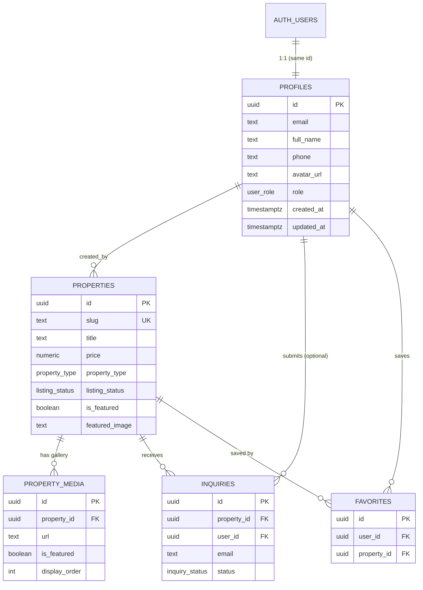

# Aura Estates — Backend Schema (Supabase / PostgreSQL)

| | |
|---|---|
| **Document** | Backend Schema v1.0 |
| **Date** | 20 October 2026 |
| **Source of truth** | `supabase/schema.sql` + `supabase/migrations/*` |

Run order for a fresh project:
1. `supabase/schema.sql`
2. `supabase/migrations/20261009_phase7_security_hardening.sql`
3. `supabase/migrations/20261011_phase_fixes_security_and_integrity.sql`
4. Promote your first admin (see §9).

---

## 1. Entity Relationship Diagram



## 2. Enumerations

| Enum | Values |
|---|---|
| `user_role` | `user`, `admin` |
| `property_type` | `villa`, `penthouse`, `estate`, `apartment`, `townhouse`, `commercial` |
| `listing_status` | `for_sale`, `for_rent`, `sold`, `pending` |
| `inquiry_status` | `new`, `contacted`, `qualified`, `closed` |

> The TypeScript `UserRole` also contains `'public'` — a **client-side** label for signed-out visitors only. It is never stored.

## 3. Tables

### 3.1 `profiles`
One row per auth user (created automatically by trigger).

| Column | Type | Null | Default | Notes |
|---|---|---|---|---|
| id | uuid | no | — | PK, FK → `auth.users(id)` ON DELETE CASCADE |
| email | text | no | — | indexed (`idx_profiles_email`) |
| full_name | text | yes | — | |
| phone | text | yes | — | |
| avatar_url | text | yes | — | |
| role | user_role | no | `'user'` | only admins may change |
| created_at | timestamptz | no | now() | |
| updated_at | timestamptz | no | now() | |

### 3.2 `properties`
| Column | Type | Null | Default / Check |
|---|---|---|---|
| id | uuid | no | `uuid_generate_v4()` PK |
| title | text | no | |
| slug | text | no | **UNIQUE** |
| description | text | no | |
| price | numeric(14,2) | no | `>= 0` |
| currency | text | no | `'USD'` |
| property_type | property_type | no | `'estate'` |
| listing_status | listing_status | no | `'for_sale'` |
| bedrooms | integer | no | `>= 0` |
| bathrooms | numeric(3,1) | no | `>= 0` |
| area_sqft | numeric(10,2) | no | `> 0` |
| year_built | integer | yes | |
| is_featured | boolean | no | `false` |
| featured_image | text | no | cover URL (kept in sync with the cover media row) |
| address, city, state, postal_code | text | no | |
| country | text | no | `'United States'` |
| latitude, longitude | numeric(10,7) | yes | reserved for map view |
| amenities | text[] | no | `'{}'` |
| created_by | uuid | yes | FK → `profiles(id)` ON DELETE SET NULL |
| created_at, updated_at | timestamptz | no | now() |

Indexes: `is_featured`, `property_type`, `listing_status`, `city`, `price`, plus (migration) composite search index and `area_sqft`.

### 3.3 `property_media`
| Column | Type | Null | Default |
|---|---|---|---|
| id | uuid | no | `uuid_generate_v4()` PK |
| property_id | uuid | no | FK → `properties(id)` ON DELETE CASCADE |
| url | text | no | |
| alt_text | text | yes | |
| is_featured | boolean | no | `false` (exactly one `true` per property by app rule) |
| display_order | integer | no | `0` |
| created_at | timestamptz | no | now() |

Index: `idx_property_media_prop_id`.

### 3.4 `inquiries`
| Column | Type | Null | Default |
|---|---|---|---|
| id | uuid | no | `uuid_generate_v4()` PK |
| property_id | uuid | yes | FK → `properties(id)` ON DELETE SET NULL |
| user_id | uuid | yes | FK → `profiles(id)` ON DELETE SET NULL |
| full_name | text | no | |
| email | text | no | |
| phone | text | yes | |
| message | text | no | |
| status | inquiry_status | no | `'new'` |
| created_at | timestamptz | no | now() |

Indexes: `property_id`, `email`, `status`, composite (status, date).

**Inquiry type / preferred date & time:** the UI collects `inquiry_type`, `preferred_date`, `preferred_time`. They are stored as a structured header line at the top of `message` and parsed back by `inquiryService`. *(Optional v1.1: promote them to real columns `inquiry_type text`, `preferred_date date`, `preferred_time text` — a simple additive migration.)*

### 3.5 `favorites`
| Column | Type | Null | Notes |
|---|---|---|---|
| id | uuid | no | PK |
| user_id | uuid | no | FK → `profiles(id)` ON DELETE CASCADE |
| property_id | uuid | no | FK → `properties(id)` ON DELETE CASCADE |
| created_at | timestamptz | no | |
| | | | `UNIQUE (user_id, property_id)` |

Index: `idx_favorites_user` + composite (user, property).

### 3.6 Planned: `site_settings` (v1.1)
Today agency settings live in the browser. To make them real and shared:
```sql
CREATE TABLE public.site_settings (
  id          boolean PRIMARY KEY DEFAULT true CHECK (id),   -- single row
  agency_name text NOT NULL, address text, phone text, email text, hours text,
  commission_rate numeric(5,4) NOT NULL DEFAULT 0.025,
  updated_at  timestamptz NOT NULL DEFAULT now()
);
-- public SELECT; admin-only INSERT/UPDATE (is_admin())
```

## 4. Functions and Triggers

| Name | Type | Purpose |
|---|---|---|
| `public.is_admin()` | function, SECURITY DEFINER, `search_path=public` | true when `auth.uid()` has role `admin`; used by every admin policy |
| `public.handle_new_user()` | function + trigger `on_auth_user_created` (AFTER INSERT on `auth.users`) | creates the `profiles` row, always role `user`, full name from metadata |
| `public.prevent_user_role_escalation()` | function + trigger `trg_prevent_role_escalation` (BEFORE UPDATE on `profiles`) | blocks role changes by signed-in non-admins; allows SQL Editor/service role (no `auth.uid()`) so the first admin can be created |

## 5. Row Level Security (final state)

RLS is **enabled on every table**.

| Table | Operation | Who | Rule |
|---|---|---|---|
| profiles | SELECT | owner | `auth.uid() = id` |
| profiles | SELECT/INSERT/UPDATE/DELETE | admin | `is_admin()` |
| profiles | UPDATE | owner | own row; role unchanged (trigger + check) |
| properties | SELECT | public | only `for_sale` / `for_rent` |
| properties | SELECT | admin | all statuses |
| properties | INSERT / UPDATE / DELETE | admin | `is_admin()` |
| property_media | SELECT | public | all |
| property_media | ALL | admin | `is_admin()` |
| inquiries | INSERT | anyone | name 1–120, valid email, message 1–6000, `user_id` NULL or = `auth.uid()`, `status='new'` |
| inquiries | SELECT | owner | `user_id = auth.uid()` |
| inquiries | ALL | admin | `is_admin()` |
| favorites | ALL | owner | `auth.uid() = user_id` |

> Behaviour to remember: when RLS blocks an UPDATE/DELETE, Postgres returns **0 rows and no error**. The app therefore always checks that at least one row was affected.

## 6. Storage

| Item | Value |
|---|---|
| Bucket | `property-images` (public read) |
| Max file size | 10 MB (server-enforced) |
| Allowed types | `image/jpeg`, `image/png`, `image/webp`, `image/avif` |
| Upload / update / delete | admins only (`is_admin()`) |
| Path convention | `residences/<timestamp>-<random>.<ext>` |

## 7. Type Mapping (DB ↔ app)

| App type (`src/types`) | DB source |
|---|---|
| `Property` | `properties` row + `property_media[]`; `location` object ← address, city, state, postal_code, country, latitude, longitude |
| `PropertyMedia` | `property_media` |
| `PropertyInquiry` | `inquiries` (+ type/date/time parsed from message header) |
| `UserProfile` | `profiles` |
| favourites | `favorites.property_id[]` for the current user |

## 8. Query Patterns

| Use | Pattern |
|---|---|
| Listing page | `properties` + embedded `property_media`, server filters on type/status/price/beds/baths/sqft/city, text search via escaped `.or(ilike…)` |
| Detail by slug | `.eq('slug', x).maybeSingle()` (UUID input → `.eq('id', x)`) |
| Saved list | `.in('id', savedIds)` |
| Related | type match → city match → latest (separate queries, no `.or`) |
| Admin enquiries | `inquiries` ordered by `created_at desc` |
| Analytics | aggregates computed from listings + enquiries in `analyticsService` |

## 9. First-Admin Bootstrap
1. Register normally in the app (creates a `user` profile).
2. Supabase → SQL Editor:
```sql
UPDATE public.profiles SET role = 'admin' WHERE email = 'you@example.com';
```
3. Sign out and back in.

## 10. Backup, Retention, Operations
- Enable Supabase daily backups (Pro) or schedule `pg_dump`.
- Delete behaviour: deleting a property removes its media and favourites; enquiries are kept with `property_id = NULL`.
- Deleting a user removes their favourites; their enquiries are kept with `user_id = NULL`.
- Monitor: Auth rate-limit settings, storage usage, slow queries (Supabase Reports).
